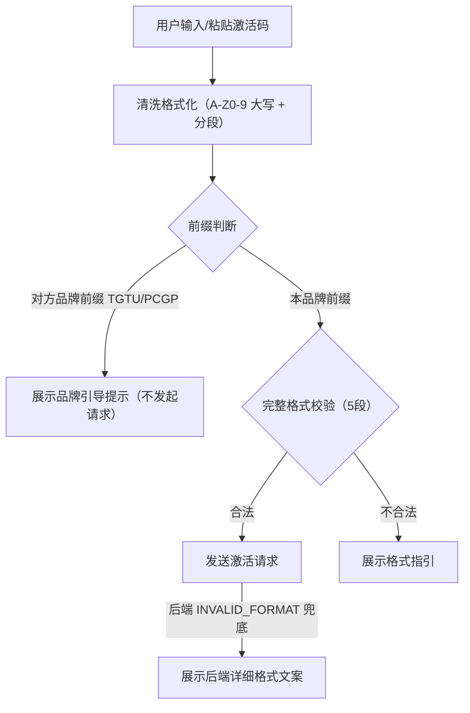

## 产品概述

针对用户误将图个吉利激活码（TGTU- 开头）输入当图客户端（仅接受 PCGP- 开头）导致「激活码格式不正确」的模糊报错问题，为两个客户端实现双向激活码品牌交叉识别：检测到对方品牌前缀时给出精准引导提示，替代晦涩报错，并避免无谓的后端请求。

## 核心功能

- 当图客户端（client）：输入以 TGTU 开头时提示「检测到输入的是图个吉利激活码，当图客户端激活码应以 PCGP- 开头」；非 PCGP 前缀的完整长度输入提示「激活码格式无效，正确格式：PCGP-XXXXX-XXXXX-XXXXX-XXXXX」
- 图个吉利客户端（TuGet-Client）：输入以 PCGP 开头时提示「检测到输入的是当图客户端激活码，图个吉利激活码应以 TGTU- 开头」；非 TGTU 格式提示「请输入 TGTU-XXXXX-XXXXX-XXXXX-XXXXX 格式的激活码」
- 实时检测：粘贴/输入对方品牌码（前缀 4 字符即可判定，零误报）即时展示提示；用户修改或清空时自动清除
- 双层机制：前端前置拦截（省掉注定失败的网络请求）+ 后端 INVALID_FORMAT 兜底时优先展示 Rust 返回的详细文案
- 不改动 Rust 核心校验逻辑与前后端接口签名

## 技术栈选择

- 前端：Vue 3 + TypeScript（当图客户端用 naive-ui；图个吉利客户端为原生 Vue SFC），复用现有 composable / 组件结构，不引入新依赖
- 后端：Rust（Tauri）校验逻辑保持不动，仅作为最终防线
- 测试：TuGet-Client 已有 vitest（npm run test:frontend），沿用补单测；client 无前端单测框架，靠 vue-tsc typecheck + vite build 验证

## 实现方案

采用「纯前端前置拦截 + 后端错误兜底解析」双层机制。核心判定依据：两品牌激活码前缀互斥（PCGP vs TGTU），本品牌码绝不可能以对方前缀开头，因此前缀判定零误报，输入满 4 字符即可给出品牌提示，无需等满 24 字符。

关键设计决策：

1. 在 client 侧 `useActivationCode.ts` 抽取单一来源的前缀常量与 `validateActivationCodeInput(raw)` 纯函数（与 Rust `validate_code_format` 规则对齐），避免前后端规则漂移；composable 通过 watch 检测品牌前缀，经回调向 UI 暴露结果，不持有 UI 状态（关注点分离）。
2. `resolveErrorMessage` 保持纯函数签名不变；品牌/格式拦截放在 `handleActivate` 提交前；后端返回 INVALID_FORMAT 时优先展示 `result.message`（Rust 已含详细格式说明）。
3. TuGet-Client 侧 `canSubmit` 放开「完整 TGTU 码 或 完整 PCGP 码」，保证用户输满串码后按钮可点击并获得引导（修复当前置灰无提示的问题）；`submit()` 中先判 PCGP 品牌提示、再判格式提示；`normalizeCode` 中实时检测 PCGP 前缀并设置 localError，重新输入自动清除。

## 执行细节

- client 侧 typecheck 命令为 `vue-tsc --noEmit`，改动后必须通过；`npm run build` 含 sync-version 与 build:scraper，注意构建耗时
- TuGet-Client 侧新增单测文件放 tests/ 根目录，参照既有 license-time-guidance.test.ts 的测试风格；`cargo test --manifest-path src-tauri/Cargo.toml` 作为回归（两端 Rust 均不应有改动）
- 文案统一采用既定对称版本，不做额外改动；注意错误提示出现/清除的时机，避免用户输入过程中误报
- 影响面控制：仅改 3 个前端文件 + 1 个新增测试文件，不动 Rust、不动接口、不动其他组件

## 架构设计



## 目录结构

```
PcGetPic/
├── client/
│   ├── src/
│   │   ├── composables/
│   │   │   └── useActivationCode.ts   # [MODIFY] 新增 CODE_PREFIX/OPPOSITE_PREFIX 常量与 validateActivationCodeInput 纯函数；watch 中实时检测对方品牌前缀并经回调暴露；resolveErrorMessage 对 INVALID_FORMAT 优先返回 result.message
│   │   └── components/
│   │       └── ActivationDialog.vue   # [MODIFY] handleActivate 提交前品牌/格式前置拦截；接入 composable 品牌检测回调驱动 errorMessage 实时展示/清除
├── TuGet-Client/
│   ├── src/
│   │   └── components/
│   │       └── ActivationDialog.vue   # [MODIFY] canSubmit 放开完整 PCGP 码；submit() 前置拦截 PCGP 品牌提示与非 TGTU 格式提示；normalizeCode 实时检测 PCGP 前缀设置 localError
│   └── tests/
│       └── license-cross-brand.test.ts # [NEW] vitest 单测：normalizeCode 保留 PCGP 输入、canSubmit 对 PCGP 完整码为真、submit 拦截 PCGP 返回品牌文案
└（两端 src-tauri Rust 代码不改动）
```

## 关键代码结构

`validateActivationCodeInput` 返回判定结果（仅接口级定义）：

```typescript
type BrandCodeCheck =
  | { kind: 'own' }            // 本品牌前缀或无前缀输入，继续常规流程
  | { kind: 'opposite' }       // 检测到对方品牌前缀，展示品牌引导文案
  | { kind: 'invalid' }        // 完整长度但格式非法，展示格式指引文案

function validateActivationCodeInput(raw: string): BrandCodeCheck
```